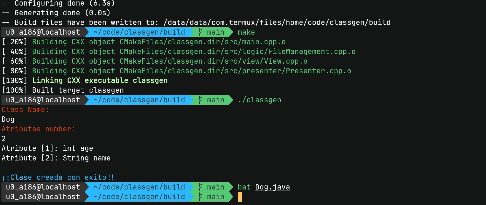
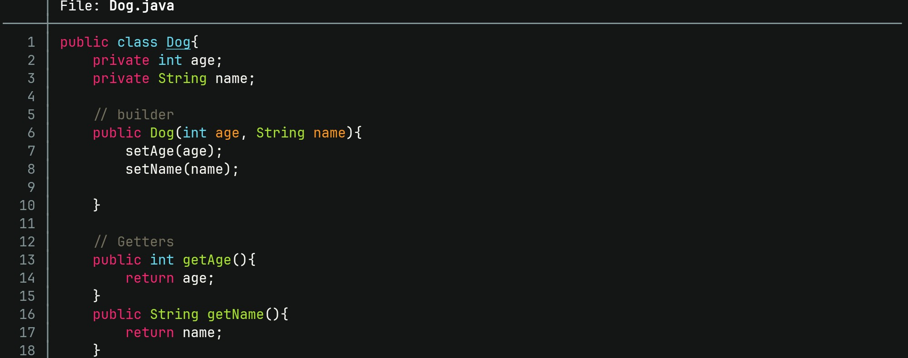

# ClassGen
ClassGen is a Java class generator.

> Author: Andrés Chaparro




## How to compile?
Make sure you have installed: gcc (or clang), make and cmake in your operative system.
And then run:


```
mkdir build && cd build
```

```
cmake ..
```

```
make
```

An executable is generated in build/. You can run the program with:

```
./classgen
```
